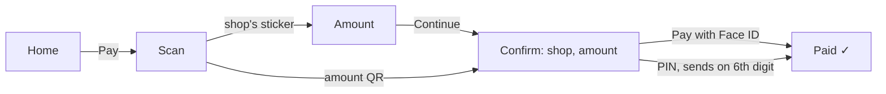
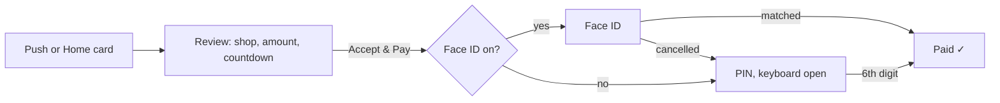
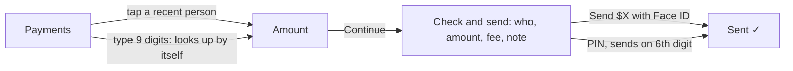
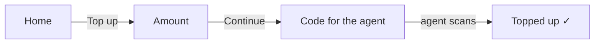
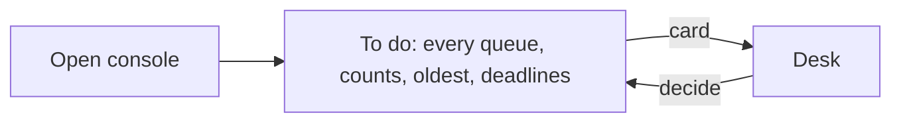

# Design flows — every user story, before and after

One page per product surface: the **customer app** (`mobile/`), the **merchant/agent
app** (`merchant-app/`) and the **admin console** (`admin/`). Each story says who it
is for, the steps today, and what changed in the 2026-11-16 flow pass.

"Taps" counts deliberate presses after the person opens the app, excluding typing
(numbers, amounts, PINs are listed separately). The visual theme is untouched:
dark kinetic and light coral in the customer app, dark glass in the merchant app,
Apple-style in the console.

## Rules the flows follow

1. **One decision per screen.** A screen that only repeats what the last one showed
   is removed (Send's separate Review step).
2. **Approving is one deliberate act, never automatic.** Face ID is offered as a
   single labelled button on a screen that shows who and how much ("Send $5.00 with
   Face ID"). It is never fired just because a screen opened. Typing the PIN is the
   other deliberate act.
3. **When a screen's only job is the PIN, the keyboard is already open,** and the
   PIN sends on the 6th digit. After a wrong PIN the boxes clear and the keyboard
   stays up.
4. **A choice of one is no choice.** Menus with a single live option are skipped
   (Top up's method list and "with an agent / find an agent" when Zaad is off).
5. **Recent first.** The people you already pay are one tap away.
6. **Nothing changes on the server.** Every change is in the apps. Face ID approval
   uses the existing `biometricChallenge` → `approveBiometric` token, which
   `verifyUserPin` already accepts wherever it accepts a PIN. Money invariants,
   guards and ledger entries are exactly as before.

---

## Customer app (Zapp Pay)

### C1 · Sign up — *new customer*
Welcome → **Get started** → phone → SMS code → set PIN ×2 → Face ID offer → terms →
Zaad number → Home.
*Unchanged.* Each step is a separate legal or security gate (consent, PIN, payout
number) and is already single-purpose.

### C2 · Sign in on my phone — *returning customer*
Welcome → **Log in** → PIN (trusted phone) → Home. A new phone adds the SMS code.
*Unchanged.* Already PIN-only on a trusted phone.

### C3 · Unlock after idle
Face ID, or the PIN pad. *Unchanged.*

### C4 · Pay a shop by scanning its QR — *customer at a counter*

| | Before | After |
|---|---|---|
| Fixed-amount QR, PIN | Pay · *tap PIN box* · 6 digits · (Confirm) | Pay · 6 digits |
| Fixed-amount QR, Face ID | Pay · Pay with Face ID | same |

**Change:** the PIN keyboard opens by itself when Face ID is off
(`PaymentConfirmScreen`, `EnterAmountScreen`). It waits until the phone has said
whether Face ID is on, so the keyboard doesn't open behind the Face ID button.

### C5 · Pay by showing my code — *customer at a till that scans*
Home → **Show QR** (code shows in place, 30 s) → the shop scans → request arrives → C6.
*Unchanged.* One tap already.

### C6 · Approve a shop's request or an online checkout

| | Before | After |
|---|---|---|
| Face ID on | Accept · *tap PIN box* · 6 digits | **Accept · Face ID** |
| Face ID off | Accept · *tap PIN box* · 6 digits | Accept · 6 digits |

**Change** (`ApprovePaymentScreen`): Accept goes straight to Face ID when it's on.
The PIN screen is the fallback and opens with the keyboard up. The challenge is
fetched while the review shows, so Face ID doesn't wait on the network. Expiry,
cancel and amount-changed handling are unchanged.

### C7 · Send money to a person — *the biggest change*

| | Before | After |
|---|---|---|
| Steps | number · amount · review · PIN · sent | person · amount · check-and-send · sent |
| Taps (Face ID on) | Continue · Continue · Confirm & Enter PIN · *PIN box* · Send = **5** + 6 PIN digits | recent person · Continue · Send with Face ID = **3**, no digits |
| Taps (PIN) | 5 + 6 digits | recent person · Continue = **2** + 6 digits |
| Typing a new number | 9 digits + Continue | 9 digits (looks up on the 9th) |

**Changes** (`PaymentsScreen`):
- **Recent people**: avatars of up to 8 people you sent to or got money from in
  your last 30 transactions, read off the history the app already loads (`utils/recentPeople.ts`, tested).
  One tap runs the same `lookupRecipient` a typed number does, so masking,
  "that's a shop" and "that's you" all still apply.
- **Auto-lookup** on a complete 9-digit local number. A number in `+…` form still
  takes Continue.
- **Review and PIN merged** into *Check and send*: avatar, amount, recipient, phone,
  fee, arrival, note, then Face ID or the PIN. A payment link's "check before you
  pay" notice stays on this screen.

### C8 · Receive from a person
Payments → **Receive** (personal QR, refreshes itself) or share a payment link.
*Unchanged.*

### C9 · Top up with cash at an agent

| | Before | After |
|---|---|---|
| Zaad top-ups off (today) | Top up · *Agent* · Continue · *I'm with an agent* = **4** | Top up · Continue = **2** |
| Zaad top-ups on | Top up · method · Continue · way | unchanged: the choice is real |

**Changes:** Home's Top up goes straight to the agent flow while it's the only method
(`DashboardScreen`, reading the same `config/app_client` switch the method list
reads). In the agent flow, Continue makes the code directly while Zaad through
agents is off, and finds an agent directly when it was opened as "find me an agent"
in dollars (`AgentTopupScreen`).

### C10 · Top up with Zaad
Home → Top up → Zaad → amount → send. *Unchanged.* Listed only once switched on.

### C11 · Cash out at an agent
| | Before | After |
|---|---|---|
| Face ID on | Get cash · amount · Continue · 6 PIN digits | Get cash · amount · **Continue with Face ID** |
| Face ID off | Get cash · amount · Continue · 6 digits | same |

**Change** (`CashOutScreen`): Face ID stands in for the PIN keypad. Cancelling it
opens the keypad. Also fixed: the Continue button was hard-coded English and is
now translated.

### C12 · History, receipt, report a problem
History tab → transaction → share / report. *Unchanged.*

### C13 · Profile, security, limits, linked apps, invite
*Unchanged.*

---

## Merchant & agent app (Zapp Pay Merchant)

### M1 · Take a payment — *shopkeeper*
Receive tab: amount (+ invoice number) → **Show QR** or **Scan their code** → Paid.
*Unchanged.* Already one screen per sale, with the amount carried into both ways.

### M2 · Counter QR (customer types the amount)
Receive → My QR. *Unchanged.*

### M3 · Top up a customer (cash in) — *agent*
Top up → scan the customer's code → **Cash received $X** → PIN → done.
**Change:** the PIN keyboard is open when the PIN step appears (−1 tap on every
top-up). The review step stays: it is where the agent chooses cash or Zaad.

### M4 · Top up by phone number
Top up → By phone → number → amount → PIN (keyboard open). *−1 tap.*

### M5 · Give cash (cash out) — *agent*
Give cash → scan the customer's code → PIN (keyboard open) → hand over cash. *−1 tap.*

### M6 · Withdraw to Zaad · M7 Send · M8 Refund a sale · M9 Move earnings to float · M10 Auto payout
Each ends in a PIN step, and on each the keyboard is now open. *−1 tap each.*

### M11 · Zaad top-ups through online agents · M12 Disputes inbox · M13 Settings
*Unchanged.* The Zaad request's PIN step keeps a tap, because its first field is an
optional Zaad reference.

### M14 · See the shop live on a computer (Zapp Business) — *shop owner*
On the computer: open zapp-business.web.app, which shows a QR. On the phone: Settings →
Zapp Business on a computer → **Sign in on a computer** → scan → "Chrome on macOS"
**Yes, sign in** → PIN → done. One decision per screen: the browser check is its own
step, because it is the one that stops a relayed QR (MERCHANT_INSIGHTS.md). The computer
only views figures. The same screen lists signed-in computers, each with **Sign out**.

---

## Admin console

### A1 · Start the day: what needs me? — *ops, compliance*

| | Before | After |
|---|---|---|
| See what's waiting | Opens on an empty customer search. Click each of 7 desks to find out | **Opens on To do**: one card per queue, overdue first |
| Know at a glance | — | Counts on every sidebar item; the browser tab reads "(10) Zapp Pay — Admin" |

**To do** (`components/TodoDesk.tsx`, `work.ts`) shows, per queue the admin's role
can work:
- **Disputes to decide**: how many are past the deadline, when the next is due (red when overdue)
- **Payouts to send**: total in dollars and shillings, oldest
- **Float to approve**: total, plus "N of yours need another admin" (maker-checker)
- **Zaad payments on hold**: total, oldest
- **Agent Zaad top-ups**: needing a decision, oldest
- **Role applications**: the first business names
- **Identity checks**: oldest submission

Plus a ledger strip (balanced / alerts / payments blocked) and links to everything
else. Counts come from the same `admin*` list callables the desks use, so they
always match. They refresh every minute while the console is in front, on return
to the window, and when you switch desks. A queue that fails to load shows "!",
never "0".

### A2 · Find a customer
| | Before | After |
|---|---|---|
| From anywhere | Customers · type · Search · click the result = **3 clicks** | press **/** · type · Enter. One match opens by itself = **0 clicks** |

### A3 · Decide a dispute, payout, float, KYC or role
To do card (or sidebar) → the desk, unchanged: every action still asks for a reason
and writes its audit entry.

### A4 · On a phone
Before: all 11 desks squeezed into the bottom tab bar. After: five tabs (To do,
Customers, Top up, Ledger, Pricing); every queue is one tap away on To do.

### A5 · Sidebar
Grouped into **Queues**, **Money** and **Settings** under To do and Customers, each
desk with its waiting count.

---

## Next candidates (not built in this pass)

- **Merchant cash in:** put the PIN under "Cash received" on one screen. Needs a
  layout that keeps the Zaad option above the keyboard.
- **Customer Home:** a Send tile next to Pay. Today Send is the Payments tab, one tap away.
- **Send again** from a transfer's detail screen.
- **Console:** keyboard shortcuts inside queues (J/K to move, A/R to decide) and
  bulk "mark payouts sent" with one reason.
